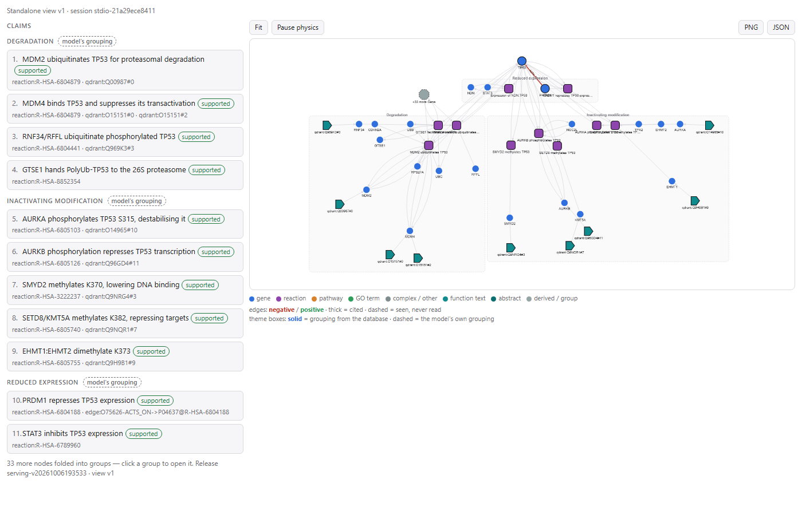

# pathwayoracle-mcp

MCP tools over the PathwayOracle knowledge base: a Qdrant store of UniProt
protein-function text, embedded with a fine-tuned BioBERT, and a Neo4j
Reactome graph. The data is built and published by
[POKnowledgeBase_ETL](https://github.com/yoyo4581/POKnowledgeBase_ETL); this
repo serves it.

| tool | what it does |
|---|---|
| `search_proteins` | shortlist proteins for a functional description, each with its best snippet as evidence |
| `read_snippets` | more windows from one protein, re-scored against a new question |
| `expand_snippet` | widen a snippet outward by sentences |
| `read_record` | one protein's whole function text |
| `collection_info` | what is indexed |

Everything is keyed by UniProt accession (`P04637`).

## Examples

Real Claude Desktop sessions against the pinned release: the answer, every tool
call it took, and the evidence panel the server drew (click the image for the
interactive page).

| question | recipe | calls | evidence |
|---|---|---|---|
| [Which proteins inhibit TP53's stability or activity?](docs/examples/tp53-inhibitors/README.md) | mechanistic | 14 | 11 claims, 41 nodes, 74 edges |
| [MDM2's regulation of TP53: publications, conditions, diseases](docs/examples/mdm2-tp53-regulation/README.md) | fine_grained | 7 | 11 claims, 24 nodes, 27 edges |

[](docs/examples/tp53-inhibitors/README.md)

To add one, copy the answer from the chat into `answer.md` and run
`scripts/export_example.py` (see its docstring) with the session id and view id
from the `show_evidence` receipt; the session's views are under
`/cache/evidence/` in the `mcp` container.

## Run it

```sh
docker compose up -d
```

The first `up` builds the server image (torch CPU and friends; slow the first
time). It downloads ~440 MB of release assets and loads both databases. It also
downloads the encoder (~420 MB) and checks its sha256 against the pin. Later
`up`s reuse all of it from named volumes. When `up` returns, everything is on
disk. The server reads the encoder into memory on its first tool call (~10 s)
and never contacts the Hub at runtime.

| | |
|---|---|
| MCP (streamable HTTP) | `http://localhost:8000/mcp` |
| Qdrant | `http://localhost:6333` |
| Neo4j Bolt / Browser | `bolt://localhost:7687` / `http://localhost:7474` |

All ports bind to `127.0.0.1` only. Nothing has auth, so do not change that
without adding some. If a port is taken (for example, you also run the backend
stack), override it: `QDRANT_REST_PORT`, `NEO4J_HTTP_PORT`, `NEO4J_BOLT_PORT`,
`MCP_PORT`.

### Claude Desktop

Claude Desktop launches servers over stdio. With the stack up, add this to
`claude_desktop_config.json`:

```json
{
  "mcpServers": {
    "pathwayoracle": {
      "command": "docker",
      "args": ["exec", "-i", "-e", "MCP_TRANSPORT=stdio",
               "pathwayoracle-mcp-1", "pathwayoracle-mcp"]
    }
  }
}
```

This starts a stdio server inside the already-running `mcp` container. It is
ready in ~2 s, and nothing is created, so nothing is left behind. Do not use
`docker compose run` here: it creates a container per launch (~17 s, past
Claude Desktop's 10 s startup limit, so the tools may not be announced), and
the container is orphaned whenever Claude Desktop stops the server abruptly.

Each Claude Desktop launch gets its own server process, which loads the encoder
on first use (~10 s with a warm cache, ~1 GB). The HTTP service shares one.

### Without Docker

```sh
uv pip install -e .          # uv resolves CPU-only torch automatically
QDRANT_URL=http://localhost:6333 \
BIOBERT_MODEL_PATH=yoyo458/BioBERT_GOUniProt_FineTuned \
BIOBERT_REVISION=dc05085095f1ae926aa014bb0a88d087bc0dce8f \
  pathwayoracle-mcp
```

With plain pip on Linux, install torch from the CPU index first
(`pip install torch==2.14.0 --index-url https://download.pytorch.org/whl/cpu`).
Otherwise PyPI gives you the ~4.4 GB CUDA build.

## Configuration

| variable | default | |
|---|---|---|
| `MCP_TRANSPORT` | `stdio` | or `streamable-http` |
| `MCP_HOST` / `MCP_PORT` | `127.0.0.1` / `8000` | HTTP only; endpoint is `/mcp` |
| `MCP_ALLOWED_HOSTS` | `localhost:*,127.0.0.1:*,[::1]:*,mcp:*` | Host headers HTTP accepts (DNS-rebinding guard) |
| `QDRANT_URL` | — | or `QDRANT_PATH` for an embedded store |
| `BIOBERT_MODEL_PATH` | Hub repo id | anything `SentenceTransformer()` accepts |
| `BIOBERT_REVISION` | — | Hub commit to pin |

## The release ↔ encoder pin

The collections were embedded by one specific set of encoder weights. If a
query is encoded by different weights, retrieval quietly gets worse: **nothing
errors**. That is why `compose.yaml` pins both together:

- `POKB_RELEASE`: `serving-v20261006193533`
- `BIOBERT_REVISION`: `dc05085` (Hub commit "Encoder 710f986575db")
- `BIOBERT_SHA256`: `710f9865…`, the sha256 of that commit's `model.safetensors`
  (`weights_sha256` in the Hub repo's `provenance.json`)

The `model-fetch` step refuses to start the server if the downloaded weights do
not hash to `BIOBERT_SHA256`. The pair itself was verified by re-encoding stored
record text with the pinned weights. The cosine to the stored vectors was
≥ 0.997 over 25 random records, against 0.21 for the untuned base model. Bump
all three together and re-check before changing any of them. Switching releases needs `docker compose down -v`; the
fetch step refuses to mix one release's seed with another's pin.

## Verify

```sh
python scripts/smoke.py http://localhost:8000/mcp
python scripts/smoke.py --stdio docker compose run --rm -i -T --no-deps -e MCP_TRANSPORT=stdio mcp
```

These call every tool through a real transport against the live stack and check
the point counts against the pinned release.

## Layout

```
src/pathwayoracle_mcp/
  server.py     transport + tool registration (ported from the backend, see its docstring)
  prefetch.py   download + verify the encoder and BM25 model (the model-fetch service)
  core/         VENDORED retriever + config from the backend -- see core/__init__.py
scripts/smoke.py
```

`core/` is a copy of the backend's `src/builders/Qdrant/core/`, because the
backend is not yet installable as a package. Change it upstream first.
